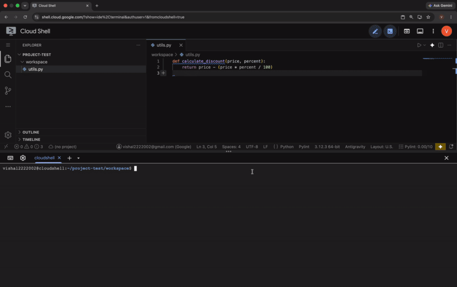
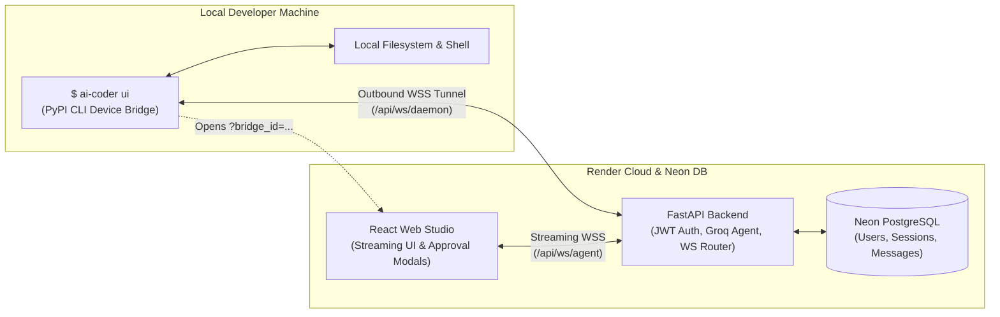

# AI Coder Sandbox

An autonomous full-stack coding agent that connects a cloud-hosted **React Web Studio** and **FastAPI** backend with your local filesystem via a zero-config **PyPI CLI device bridge** (`ai-coder-sandbox`).

## Live Demo



- **Watch Full 75s HD Walkthrough:** [Download / Play `demo.mp4` (v0.1.0 Release)](https://github.com/Vishal-hassani09/ai-agent-sandbox/releases/download/v0.1.0/demo.mp4)
- **Live Web Studio:** <https://ai-agent-sandbox-frontend.onrender.com>
- **Backend API Docs:** <https://ai-agent-sandbox-backend-dgcj.onrender.com/docs>
- **PyPI Package:** <https://pypi.org/project/ai-coder-sandbox/>

## Key Features

- **Local Device Bridge (`ai-coder ui`):** Launches a lightweight outbound WebSocket bridge in your active directory and pairs with the cloud Web Studio—giving the remote agent direct read, write, and command execution access to your local workspace without manual file uploads.
- **Interactive Terminal TUI (`ai-coder cli`):** Terminal-native coding agent built with `prompt_toolkit` and `rich`, backed by the same cloud authentication and persistent session history.
- **Human-in-the-Loop Tool Permissions:** Explicit approval prompts (`Allow once`, `Always allow during this session`, `Deny`) before executing shell commands or modifying local files.
- **Multi-Step Autonomous Tool Loop:** Supports file reading, surgical file editing, glob search, directory listing, and sandboxed shell execution powered by Groq LLMs.
- **Persistent Sessions & Auth:** JWT + email OTP verification (with SVG CAPTCHA rate-limiting), auto-generated session titles, and full conversation persistence in Neon PostgreSQL.

## Architecture



## Quick Start

### 1. Install the CLI Globally from PyPI

```bash
pip install ai-coder-sandbox
```

*(Or install in an isolated environment using `pipx install ai-coder-sandbox`.)*

### 2. Launch Web Studio Mode (Recommended)

Navigate to any local project folder and start the device bridge:

```bash
cd your-project-folder
ai-coder ui
```

This prints a paired URL (`https://ai-agent-sandbox-frontend.onrender.com/?bridge_id=...`), connects your local directory over WebSockets once you sign in, and lets you collaborate with the agent directly on your local files.

### 3. Launch Pure Terminal CLI Mode

```bash
ai-coder cli
```

## Tech Stack

| Layer | Technologies |
| :--- | :--- |
| **Backend** | Python 3.12, FastAPI, Uvicorn, WebSockets, SQLAlchemy (Async), Pydantic Settings, Groq SDK |
| **Database** | PostgreSQL (Neon Serverless), SQLite (`aiosqlite` for CI test suite) |
| **Frontend** | React, Vite, Custom WebSocket Streaming Client |
| **CLI & Packaging** | `prompt_toolkit`, `rich`, `httpx`, `websockets`, published on PyPI (`setuptools`) |
| **Deployment & CI** | Docker, Render Blueprint (`render.yaml`), GitHub Actions (`pytest` + `vitest`) |

## Local Development

```bash
git clone https://github.com/Vishal-hassani09/ai-agent-sandbox.git
cd ai-agent-sandbox

# 1. Start Backend
cd backend
python -m venv .venv && source .venv/bin/activate
pip install -e .
uvicorn app.api.main:app --reload

# 2. Start Frontend (in a second terminal)
cd ../frontend
npm install
npm run dev
```